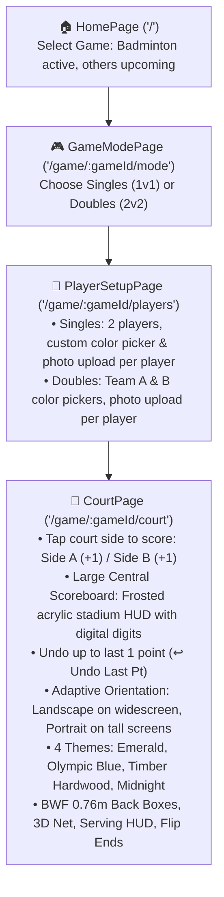

# 🏸 Shuttle Score — Project Context & Resume Guide

> **Quick Resume Prompt for Next Session:**
> *"We are building Shuttle Score located at `D:\My Works\Development\shuttle-score`. Please read `PROJECT_STATUS.md` and continue with the next step."*

---

## 📌 Project Overview
- **App Name:** Shuttle Score
- **GitHub Repository:** [https://github.com/Pradeep-elangovan/Shuttle-score](https://github.com/Pradeep-elangovan/Shuttle-score)
- **Local Directory:** `D:\My Works\Development\shuttle-score`
- **Goal:** Mobile & tablet-first scoreboard web app with an adaptive landscape/portrait tournament-grade interactive court UI, tap-to-score marking, central broadcast scoreboard, and undo capabilities. Intended to be wrapped and distributed as an Android APK (via Capacitor) on the Google Play Store. Future roadmap includes scaling to other racket/ball sports.

---

## 🛠️ Tech Stack & Architecture
- **Framework:** React 19 (`react`, `react-dom`)
- **Language:** TypeScript (`strict`, modern ES target)
- **Bundler:** Vite 8 (`@tailwindcss/vite`, `@vitejs/plugin-react`)
- **Styling:** Tailwind CSS v4 (`@import "tailwindcss";`, custom tokens in `src/index.css`)
- **Routing:** React Router v7 (`react-router-dom`)
- **Icons:** `lucide-react` + custom SVG shuttlecock
- **Image Processing:** HTML Canvas client-side resize utility (`resizeImageFile`)
- **Mobile Packaging (Planned):** Capacitor (`@capacitor/core`, `@capacitor/android`, `@capacitor/cli`)

---

## 🚦 Current Application Flow



---

## 📂 Source Code Map

```
shuttle-score/
├── index.html                         # Mobile-optimized viewport, dark theme-color
├── vite.config.ts                     # React + Tailwind v4 Vite plugin
├── package.json                       # Scripts: dev, build, preview
├── PROJECT_STATUS.md                  # This file
├── README.md                          # Repository documentation
├── public/
│   └── favicon.svg                    # Shuttlecock SVG favicon
└── src/
    ├── main.tsx                       # Entry point wrapped in BrowserRouter
    ├── App.tsx                        # Unconstrained full-screen wrapper for Court, centered card for setup
    ├── index.css                      # Tailwind base, dark palette tokens, score animations, float-up badges
    ├── pages/
    │   ├── HomePage.tsx               # Game card selector (Badminton available; TT, Tennis, Volleyball 'Soon')
    │   ├── GameModePage.tsx           # Singles (1v1) & Doubles (2v2) mode cards
    │   ├── PlayerSetupPage.tsx        # Player details form with ColorPicker & PlayerAvatarUpload
    │   └── CourtPage.tsx              # Court wrapper with Tap-to-Score, Large Central Scoreboard & 1-Point Undo
    ├── components/
    │   ├── BadmintonCourt.tsx         # Responsive SVG court: Tap zones for scoring, 4 themes, Back Boxes, 3D net
    │   ├── ColorPicker.tsx            # 8 vibrant preset swatches + native HTML5 color picker
    │   ├── PlayerAvatarUpload.tsx     # Photo uploader with preview, canvas resize & remove button
    │   └── icons/
    │       └── ShuttlecockIcon.tsx    # Detailed custom vector shuttlecock icon
    └── utils/
        └── imageUtils.ts              # Lightweight canvas-based image resizer & initial extractor
```

---

## 🔄 Completed Features
1. **Game Selection Screen (`/`)**:
   - Clean dark-mode layout with floating shuttlecock branding.
   - Badminton selectable; Table Tennis, Tennis, Volleyball marked as "Soon".
2. **Game Mode Screen (`/game/:gameId/mode`)**:
   - Clean card selection for Singles (1 vs 1) and Doubles (2 vs 2).
3. **Player Details Form (`/game/:gameId/players`)**:
   - **Singles**: 2 players with individual color picker (8 sports presets + custom picker) & photo uploader.
   - **Doubles**: Team A & Team B color pickers, individual photo uploader, Name, Gender, and DOB for each of the 4 players.
   - Client-side image compression keeps photos lightweight (~30KB JPEG).
4. **Court Score Marking & Large Center Scoreboard (`/game/:gameId/court`)**:
   - **Tap-to-Score on Court Sides**:
     - Tap anywhere on Side A (Top in portrait / Left in landscape) awards `+1` point to Side A.
     - Tap anywhere on Side B (Bottom in portrait / Right in landscape) awards `+1` point to Side B.
     - Automatically accounts for "Flip Ends" (Side 1 vs Side 2).
     - Flash wave animation on tapped court half with subtle haptic vibration.
   - **Large Center Scoreboard**:
     - Positioned right in the center of the page over the net with stadium acrylic styling.
     - Large digital digits (`text-5xl sm:text-7xl font-mono`) styled with respective player/team colors.
     - Live team names & color dot badges.
     - Floating `+1` / `-1` point pop animation.
   - **Undo up to Last 1 Point**:
     - `↩ Undo Last Pt` button activates whenever a point is scored.
     - Clicking reverts the score by 1 point and then locks until another point is added.
     - `↺ Reset` button to reset to `0 - 0`.
5. **Adaptive Landscape & Portrait Badminton Court**:
   - Automatic detection: Landscape on widescreen (`1340 × 610`), Portrait on tall screens (`610 × 1340`).
   - Manual Orientation button (`Auto / Landscape / Portrait`).
   - BWF 0.76m Back Boxes, 4 themes, 3D net with posts, and serving HUD.

---

## 🚀 Running the App
- **Start Dev Server:**
  ```powershell
  Set-Location "D:\My Works\Development\shuttle-score"
  npm run dev
  ```
- **Local URL:** `http://localhost:5173`
- **Network URL (Mobile test):** Check terminal output (e.g. `http://192.168.x.x:5173`)
- **Build Verification:**
  ```powershell
  npm run build
  ```

---

## 📋 Ready for Next Phase
1. **Match Rules Engine**:
   - Standard 21-point game, deuce logic (up to 30), best of 3 games.
   - Automatic server & receiver rotation following odd/even service box rules.
   - Game point / Match point announcements.
2. **Capacitor Integration**: Generate Android studio project & build APK for Play Store release.
