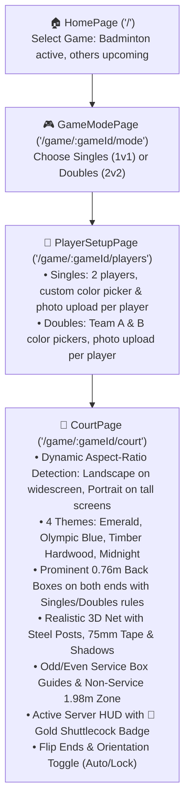

# 🏸 Shuttle Score — Project Context & Resume Guide

> **Quick Resume Prompt for Next Session:**
> *"We are building Shuttle Score located at `D:\My Works\Development\shuttle-score`. Please read `PROJECT_STATUS.md` and continue with the next step."*

---

## 📌 Project Overview
- **App Name:** Shuttle Score
- **GitHub Repository:** [https://github.com/Pradeep-elangovan/Shuttle-score](https://github.com/Pradeep-elangovan/Shuttle-score)
- **Local Directory:** `D:\My Works\Development\shuttle-score`
- **Goal:** Mobile & tablet-first scoreboard web app with an adaptive landscape/portrait tournament-grade interactive court UI, intended to be wrapped and distributed as an Android APK (via Capacitor) on the Google Play Store. Future roadmap includes scaling to other racket/ball sports.

---

## 🛠️ Tech Stack & Architecture
- **Framework:** React 19 (`react`, `react-dom`)
- **Language:** TypeScript (`strict`, modern ES target)
- **Bundler:** Vite 8 (`@tailwindcss/vite`, `@vitejs/plugin-react`)
- **Styling:** Tailwind CSS v4 (`@import "tailwindcss";`, custom tokens in `src/index.css`)
- **Routing:** React Router v7 (`react-router-dom`)
- **Icons:** `lucide-react` + custom SVG shuttlecock
- **Image Processing:** HTML Canvas client-side resize utility (`resizeImageFile`)
- **Mobile Packaging (Planned):** Capacitor (`@capacitor/core`, `@capacitor/android`, `@capacitor/cli`)

---

## 🚦 Current Application Flow



---

## 📂 Source Code Map

```
shuttle-score/
├── index.html                         # Mobile-optimized viewport, dark theme-color
├── vite.config.ts                     # React + Tailwind v4 Vite plugin
├── package.json                       # Scripts: dev, build, preview
├── PROJECT_STATUS.md                  # This file
├── README.md                          # Repository documentation
├── public/
│   └── favicon.svg                    # Shuttlecock SVG favicon
└── src/
    ├── main.tsx                       # Entry point wrapped in BrowserRouter
    ├── App.tsx                        # Unconstrained full-screen wrapper for Court, centered card for setup
    ├── index.css                      # Tailwind base, dark palette tokens, tap-scale, float animations
    ├── pages/
    │   ├── HomePage.tsx               # Game card selector (Badminton available; TT, Tennis, Volleyball 'Soon')
    │   ├── GameModePage.tsx           # Singles (1v1) & Doubles (2v2) mode cards
    │   ├── PlayerSetupPage.tsx        # Player details form with ColorPicker & PlayerAvatarUpload
    │   └── CourtPage.tsx              # Court wrapper with Aspect-Ratio detection, Landscape/Portrait toggle & HUD
    ├── components/
    │   ├── BadmintonCourt.tsx         # Responsive SVG court: Full Landscape (1340x610) & Portrait (610x1340) engines
    │   ├── ColorPicker.tsx            # 8 vibrant preset swatches + native HTML5 color picker
    │   ├── PlayerAvatarUpload.tsx     # Photo uploader with preview, canvas resize & remove button
    │   └── icons/
    │       └── ShuttlecockIcon.tsx    # Detailed custom vector shuttlecock icon
    └── utils/
        └── imageUtils.ts              # Lightweight canvas-based image resizer & initial extractor
```

---

## 🔄 Completed Features
1. **Game Selection Screen (`/`)**:
   - Clean dark-mode layout with floating shuttlecock branding.
   - Badminton selectable; Table Tennis, Tennis, Volleyball marked as "Soon".
2. **Game Mode Screen (`/game/:gameId/mode`)**:
   - Clean card selection for Singles (1 vs 1) and Doubles (2 vs 2).
3. **Player Details Form (`/game/:gameId/players`)**:
   - **Singles**: 2 players with individual color picker (8 sports presets + custom picker) & photo uploader.
   - **Doubles**: Team A & Team B color pickers, individual photo uploader, Name, Gender, and DOB for each of the 4 players.
   - Client-side image compression keeps photos lightweight (~30KB JPEG).
4. **Adaptive Landscape & Portrait Badminton Court (`/game/:gameId/court`)**:
   - **Dynamic Orientation Detection**:
     - **Higher Width (Widescreen, Desktop, Tablet Landscape, Sideways Phone)**: Automatically switches to **Landscape Mode** (`1340 × 610`), horizontal court with vertical net in the center dividing Left (Side A) and Right (Side B).
     - **Higher Height (Mobile Portrait, Tablet Portrait)**: Automatically switches to **Portrait Mode** (`610 × 1340`), vertical court with horizontal net dividing Top and Bottom.
     - **Orientation Button**: Allows cycling/locking between `Auto`, `Landscape`, and `Portrait`.
   - **Prominent 0.76m Back Boxes (Rear Gallery)**:
     - The doubles long service line is **always drawn** on both ends in all modes.
     - Divided by the center line into Left Back Box and Right Back Box.
     - In Doubles: Displays `BACK BOX (0.76M) • OUT ON SERVE` with diagonal hazard/warning striping.
     - In Singles: Displays `BACK BOX (0.76M) • IN`.
     - Tapping any back box displays a rule explainer card.
   - **4 Authentic Court Themes**:
     - 🟢 **Emerald**: Classic Yonex BWF World Tour green mat
     - 🔵 **Olympic**: Deep ocean turquoise mat from Paris/All-England
     - 🪵 **Timber**: Tournament maple hardwood parquet with wood grain overlay
     - 🌑 **Midnight**: Obsidian carbon mat with glowing cyan lines
   - **Realistic 3D Net**:
     - Dual steel net posts on doubles sidelines with tension wheels.
     - 75mm white vinyl cord tape, dark woven mesh weave, and projected 3D shadow.
     - Center net height measurement badge (1.524m).
   - **Player Tokens & Serving HUD**:
     - 3D avatar tokens with team/player color halos, metallic bezels, and drop shadows.
     - Active server badge with golden 🏸 shuttlecock icon.
     - Tap any player or click "Switch Server" to reassign the serve.
     - **Flip Ends**: One-tap court rotation button to switch ends (Side A ↔ Side B).

---

## 🚀 Running the App
- **Start Dev Server:**
  ```powershell
  Set-Location "D:\My Works\Development\shuttle-score"
  npm run dev
  ```
- **Local URL:** `http://localhost:5173`
- **Network URL (Mobile test):** Check terminal output (e.g. `http://192.168.x.x:5173`)
- **Build Verification:**
  ```powershell
  npm run build
  ```

---

## 📋 Ready for Next Phase
1. **Live Scoring Engine**:
   - Tap-to-score / swipe gestures or large score counter digits.
   - Server & receiver rotation logic following official BWF rules (odd/even service courts).
   - Game & match point detection, deuce (first to 2-point lead or capped at 30).
   - Undo/redo stack.
2. **Capacitor Integration**: Generate Android studio project & build APK for Play Store release.
