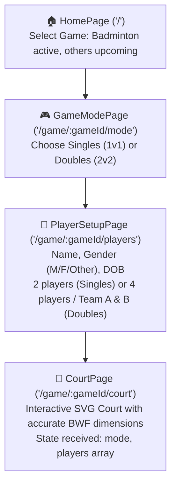

# 🏸 Shuttle Score — Project Context & Resume Guide

> **Quick Resume Prompt for Next Session:**
> *"We are building Shuttle Score located at `D:\My Works\Development\shuttle-score`. Please read `PROJECT_STATUS.md` and continue with the next step."*

---

## 📌 Project Overview
- **App Name:** Shuttle Score
- **GitHub Repository:** [https://github.com/Pradeep-elangovan/Shuttle-score](https://github.com/Pradeep-elangovan/Shuttle-score)
- **Local Directory:** `D:\My Works\Development\shuttle-score`
- **Goal:** Mobile & tablet-first scoreboard web app with an interactive court UI, intended to be wrapped and distributed as an Android APK (via Capacitor) on the Google Play Store. Future roadmap includes scaling to other racket/ball sports.

---

## 🛠️ Tech Stack & Architecture
- **Framework:** React 19 (`react`, `react-dom`)
- **Language:** TypeScript (`strict`, modern ES target)
- **Bundler:** Vite 8 (`@tailwindcss/vite`, `@vitejs/plugin-react`)
- **Styling:** Tailwind CSS v4 (`@import "tailwindcss";`, custom tokens in `src/index.css`)
- **Routing:** React Router v7 (`react-router-dom`)
- **Icons:** `lucide-react` + custom SVG shuttlecock
- **Mobile Packaging (Planned):** Capacitor (`@capacitor/core`, `@capacitor/android`, `@capacitor/cli`)

---

## 🚦 Current Application Flow



---

## 📂 Source Code Map

```
shuttle-score/
├── index.html                         # Mobile-optimized viewport, dark theme-color
├── vite.config.ts                     # React + Tailwind v4 Vite plugin
├── package.json                       # Scripts: dev, build, preview
├── PROJECT_STATUS.md                  # This file
├── public/
│   └── favicon.svg                    # Shuttlecock SVG favicon
└── src/
    ├── main.tsx                       # Entry point wrapped in BrowserRouter
    ├── App.tsx                        # Route table (/, /game/:gameId/mode, /game/:gameId/players, /game/:gameId/court)
    ├── index.css                      # Tailwind base, dark palette tokens, tap-scale, float animations
    ├── pages/
    │   ├── HomePage.tsx               # Game card selector (Badminton available; TT, Tennis, Volleyball 'Soon')
    │   ├── GameModePage.tsx           # Singles (1v1) & Doubles (2v2) mode cards
    │   ├── PlayerSetupPage.tsx        # Player details form (Name, Gender pills, DOB datepicker, validation)
    │   └── CourtPage.tsx              # Court wrapper with top action bar, mode label, settings icon
    └── components/
        ├── BadmintonCourt.tsx         # Responsive SVG court, BWF ratios (13.4m x 6.1m), interactive zones, net/posts
        └── icons/
            └── ShuttlecockIcon.tsx    # Detailed custom vector shuttlecock icon
```

---

## 🔄 Completed Features
1. **Game Selection Screen (`/`)**:
   - Clean dark-mode layout with floating shuttlecock branding.
   - Badminton selectable; Table Tennis, Tennis, Volleyball marked as "Soon".
2. **Game Mode Screen (`/game/:gameId/mode`)**:
   - Clean card selection for Singles (1 vs 1) and Doubles (2 vs 2).
3. **Player Details Form (`/game/:gameId/players`)**:
   - Singles: Collects details for 2 players.
   - Doubles: Collects details for 4 players divided into Team A & Team B.
   - Fields captured per player:
     - `name`: Text input with error highlight.
     - `gender`: Tap-toggle button pills (`Male ♂`, `Female ♀`, `Other ⚧`).
     - `dob`: Date picker (`YYYY-MM-DD`).
   - Validation prevents progression until all fields are filled.
   - State passed cleanly via router location state to the court page.
4. **Interactive Badminton Court (`/game/:gameId/court`)**:
   - Accurate BWF dimensions rendered via scalable SVG (`viewBox`).
   - Singles vs Doubles court lines dynamically toggled (tramlines dimmed in singles, doubles long service line rendered in doubles).
   - Tap-to-inspect on 8 individual court zones with highlight animation.
   - Mobile-first layout with header controls and clean contrast.

---

## 🚀 Running the App
- **Start Dev Server:**
  ```powershell
  Set-Location "D:\My Works\Development\shuttle-score"
  npm run dev
  ```
- **Local URL:** `http://localhost:5173`
- **Build Verification:**
  ```powershell
  npm run build
  ```

---

## 📋 Ready for Next Phase
1. **Displaying player names & positions on the court** (server / receiver indicator).
2. **Scorekeeping Engine**:
   - Point addition / subtraction (tap zone or large score controls).
   - Server rotation & court position swap based on odd/even points.
   - Deuce logic (up to 30 points) & game/match point detection.
   - Undo/redo stack.
3. **Match Setting Options**: Best of 3 sets, 11/15/21 target points, service interval breaks.
4. **Capacitor Integration**: Generate Android studio project & build APK for Play Store release.
