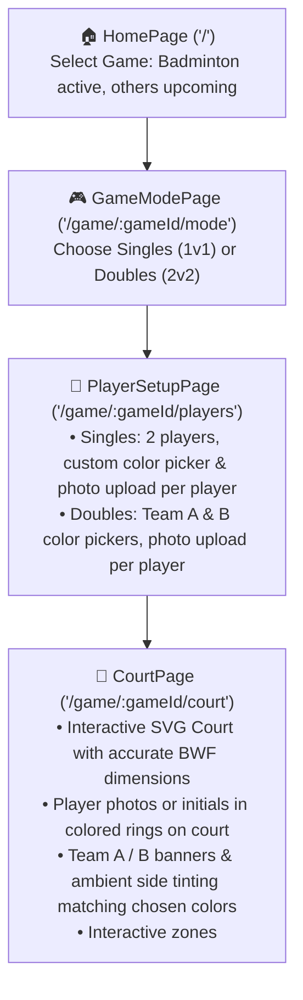

# 🏸 Shuttle Score — Project Context & Resume Guide

> **Quick Resume Prompt for Next Session:**
> *"We are building Shuttle Score located at `D:\My Works\Development\shuttle-score`. Please read `PROJECT_STATUS.md` and continue with the next step."*

---

## 📌 Project Overview
- **App Name:** Shuttle Score
- **GitHub Repository:** [https://github.com/Pradeep-elangovan/Shuttle-score](https://github.com/Pradeep-elangovan/Shuttle-score)
- **Local Directory:** `D:\My Works\Development\shuttle-score`
- **Goal:** Mobile & tablet-first scoreboard web app with an interactive court UI, intended to be wrapped and distributed as an Android APK (via Capacitor) on the Google Play Store. Future roadmap includes scaling to other racket/ball sports.

---

## 🛠️ Tech Stack & Architecture
- **Framework:** React 19 (`react`, `react-dom`)
- **Language:** TypeScript (`strict`, modern ES target)
- **Bundler:** Vite 8 (`@tailwindcss/vite`, `@vitejs/plugin-react`)
- **Styling:** Tailwind CSS v4 (`@import "tailwindcss";`, custom tokens in `src/index.css`)
- **Routing:** React Router v7 (`react-router-dom`)
- **Icons:** `lucide-react` + custom SVG shuttlecock
- **Image Processing:** HTML Canvas client-side resize utility (`resizeImageFile`)
- **Mobile Packaging (Planned):** Capacitor (`@capacitor/core`, `@capacitor/android`, `@capacitor/cli`)

---

## 🚦 Current Application Flow



---

## 📂 Source Code Map

```
shuttle-score/
├── index.html                         # Mobile-optimized viewport, dark theme-color
├── vite.config.ts                     # React + Tailwind v4 Vite plugin
├── package.json                       # Scripts: dev, build, preview
├── PROJECT_STATUS.md                  # This file
├── README.md                          # Repository documentation
├── public/
│   └── favicon.svg                    # Shuttlecock SVG favicon
└── src/
    ├── main.tsx                       # Entry point wrapped in BrowserRouter
    ├── App.tsx                        # Route table (/, /game/:gameId/mode, /game/:gameId/players, /game/:gameId/court)
    ├── index.css                      # Tailwind base, dark palette tokens, tap-scale, float animations
    ├── pages/
    │   ├── HomePage.tsx               # Game card selector (Badminton available; TT, Tennis, Volleyball 'Soon')
    │   ├── GameModePage.tsx           # Singles (1v1) & Doubles (2v2) mode cards
    │   ├── PlayerSetupPage.tsx        # Player details form with ColorPicker & PlayerAvatarUpload
    │   └── CourtPage.tsx              # Court wrapper with top action bar, mode label, settings/reset icon
    ├── components/
    │   ├── BadmintonCourt.tsx         # SVG court with player avatars, color rings, side tints, interactive zones
    │   ├── ColorPicker.tsx            # 8 vibrant preset swatches + native HTML5 color picker
    │   ├── PlayerAvatarUpload.tsx     # Photo uploader with preview, canvas resize & remove button
    │   └── icons/
    │       └── ShuttlecockIcon.tsx    # Detailed custom vector shuttlecock icon
    └── utils/
        └── imageUtils.ts              # Lightweight canvas-based image resizer & initial extractor
```

---

## 🔄 Completed Features
1. **Game Selection Screen (`/`)**:
   - Clean dark-mode layout with floating shuttlecock branding.
   - Badminton selectable; Table Tennis, Tennis, Volleyball marked as "Soon".
2. **Game Mode Screen (`/game/:gameId/mode`)**:
   - Clean card selection for Singles (1 vs 1) and Doubles (2 vs 2).
3. **Player Details Form (`/game/:gameId/players`)**:
   - **Singles**:
     - 2 players with individual color picker (8 sports presets + custom picker).
     - Individual photo uploader with preview, live camera capture, and remove option.
     - Name, Gender toggle pills (`Male ♂`, `Female ♀`, `Other ⚧`), and Date of Birth validation.
   - **Doubles**:
     - Team A header with Team A color picker (applies to Player 1 & 2).
     - Team B header with Team B color picker (applies to Player 3 & 4).
     - Individual photo uploader, Name, Gender, and DOB for each of the 4 players.
   - Client-side image compression keeps photos lightweight (~30KB JPEG).
4. **Interactive Badminton Court (`/game/:gameId/court`)**:
   - Accurate BWF dimensions rendered via scalable SVG (`viewBox`).
   - **Singles**: Player 1 centered on top side, Player 2 centered on bottom side with circular avatar images (or initials), border rings in assigned color, and name pill badges.
   - **Doubles**: Team A (Players 1 & 2) placed on top service courts; Team B (Players 3 & 4) placed on bottom service courts with team colors, rings, and team banners.
   - **Side Ambient Tints**: Top half subtly tinted with Side A / Team A color; bottom half tinted with Side B / Team B color.
   - Singles vs Doubles court lines dynamically toggled (tramlines dimmed in singles, doubles long service lines rendered in doubles).
   - Tap-to-inspect on 8 individual court zones and player markers.

---

## 🚀 Running the App
- **Start Dev Server:**
  ```powershell
  Set-Location "D:\My Works\Development\shuttle-score"
  npm run dev
  ```
- **Local URL:** `http://localhost:5173`
- **Build Verification:**
  ```powershell
  npm run build
  ```

---

## 📋 Ready for Next Phase
1. **Live Scoring Engine**:
   - Point increment / decrement (e.g. tap player / court half or large score counters).
   - Server & receiver rotation logic following official BWF rules (odd/even service courts).
   - Game & match point detection, deuce (first to 2-point lead or capped at 30).
   - Undo/redo stack.
2. **Capacitor Integration**: Generate Android studio project & build APK for Play Store release.
